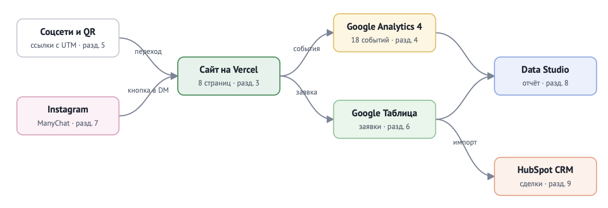

# Ветеринарная клиника «ЛапаДок» — сайт и сквозная аналитика заявок

Курсовая работа по дисциплине ОП.03 «Информационные технологии», ТЗ № ТЗ-06/2026.
Исполнитель: Кононова Ника, группа РПО3.

Сайт кампании «Комплексная вакцинация −20 % в ноябре»: каждый посетитель приходит с меткой источника, каждая заявка попадает в Google Таблицу и CRM HubSpot, а руководитель видит на дашборде Looker Studio, какой канал приводит клиентов.



## Ссылки

| Что | Ссылка |
|---|---|
| Сайт | https://tz-06-vetklinika-lapadok.vercel.app |
| Таблица заявок | https://docs.google.com/spreadsheets/d/1k8PA1CkCwjY_hQaVpb9vShLfIKEiV_G_ti86mwSy5Q8/edit?gid=0#gid=0 |
| Дашборд DataLens | https://datastudio.google.com/u/0/reporting/cddf4c15-4af3-4426-8722-7805f114949e/page/0aGCG |
| Instagram и Reel с автоответом | https://www.instagram.com/klausl19/?hl=ru и https://www.instagram.com/p/De8E6ZMB6vk/?hl=ru |
| ВКонтакте · Telegram · YouTube | https://tz-06-vetklinika-lapadok.vercel.app/?utm_source=vk&utm_medium=social&utm_campaign=vetklinika_lapadok · https://tz-06-vetklinika-lapadok.vercel.app/?utm_source=telegram&utm_medium=social&utm_campaign=vetklinika_lapadok · https://tz-06-vetklinika-lapadok.vercel.app/?utm_source=youtube&utm_medium=video&utm_campaign=vetklinika_lapadok |
| Описание работы | [docs/opisanie.md](docs/opisanie.md) |
| Презентация к защите | [presentation/zashchita.pdf](presentation/zashchita.pdf) |

Ресурс GA4: `G-___`. Доступ Viewer к ресурсу GA4 выдан: ___ (e-mail Заказчика).

## Что сделано

| Часть | Результат |
|---|---|
| Сайт | 8 страниц, статический HTML, Vercel, Lighthouse: ___ / ___ / ___ |
| GA4 | 20 событий, 7 пользовательских параметров, ключевые: `generate_lead`, `contact_click`, `messenger_click` |
| UTM | 12 ссылок в реестре, публикации в QR соцсетях, QR на афише |
| Заявки | форма → Apps Script → лист `leads`, проверка полей и повторов |
| Instagram | ManyChat, две ветки: `АПТЕЧКА` и `ЩЕНОК` |
| Отчёты | Reports, Explore, воронка, путь, дашборд DataLens из трёх вкладок |

## Технологии

HTML, CSS, JavaScript · Google Analytics 4 · Google Таблицы и Apps Script ·
ManyChat · Yandex DataLens · GitHub и Vercel. Сайт создан с помощью ___
(запросы — в [docs/prompts.md](docs/prompts.md)).

## Структура

```text
index.html …         страницы сайта
js/analytics.js      все события GA4
apps-script/Code.gs  приёмник заявок
docs/                описание, реестр UTM, события, записка, схема
screens/             кадры-доказательства по разделам ТЗ
presentation/        презентация к защите
```

## Итог

Не получилось: ___
Нейросеть использовалась для: ___
